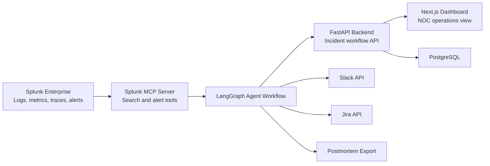

# Architecture

## Agent Flow

1. Incident Detection Agent consumes Splunk alerts and anomaly scores.
2. Investigation Agent queries Splunk logs, metrics, traces, and deployment history.
3. Root Cause Agent correlates evidence and assigns confidence.
4. Impact Analysis Agent estimates service, user, and revenue impact.
5. Response Coordinator Agent evaluates rollback, scaling, restart, and escalation actions.
6. Communication Agent drafts Slack and stakeholder updates.
7. Ticket Agent creates Jira remediation work.
8. Postmortem Agent exports a final incident report.

The current implementation exposes this complete workflow through deterministic demo data so judges can see every required system interaction without needing paid external credentials.
